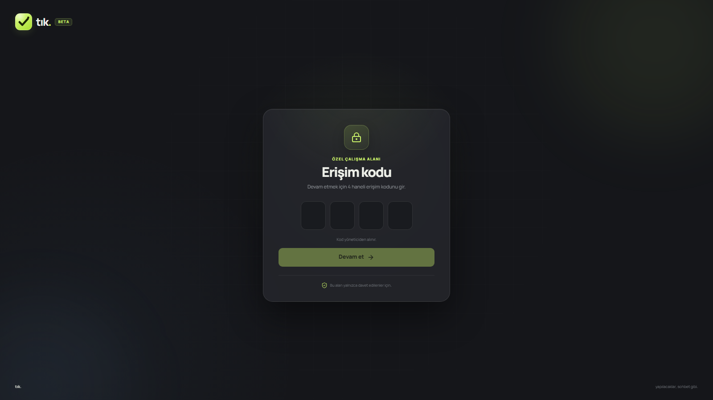
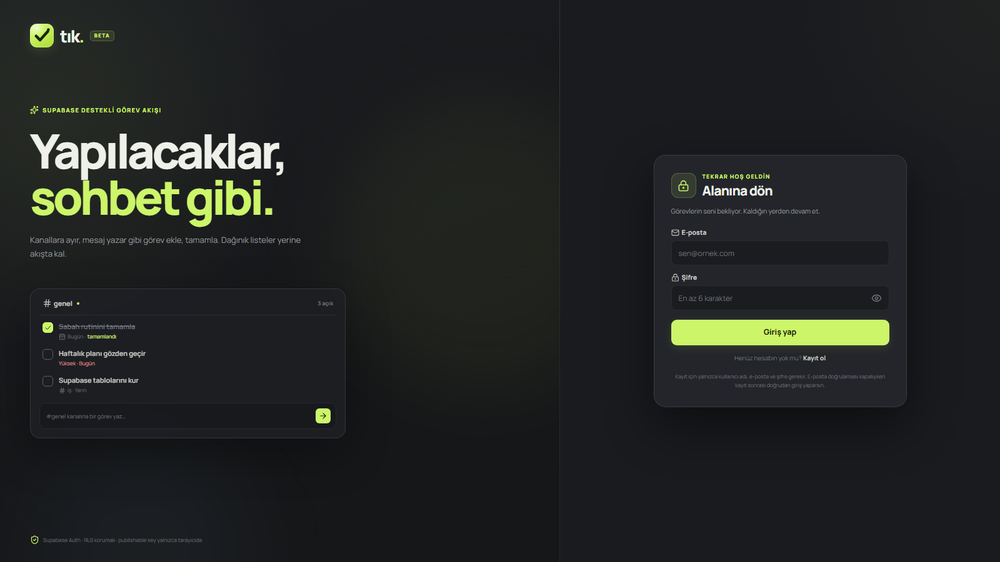
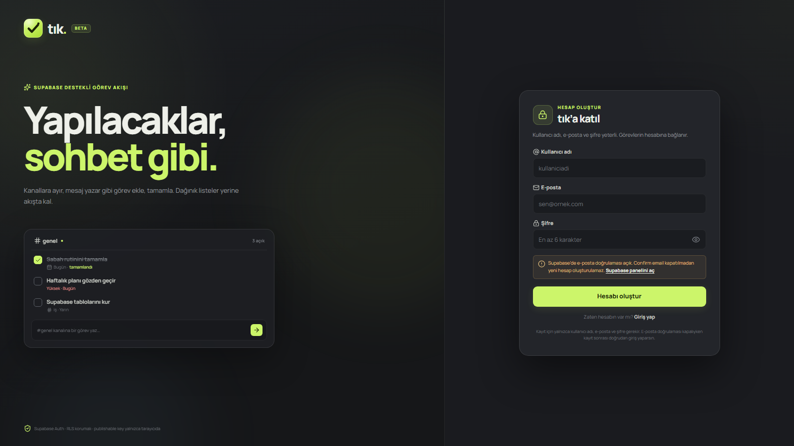

# tık.

**Yapılacaklar, sohbet gibi.** Discord’un kanal/mesaj düzeninden ilham alan, Supabase destekli görev takip uygulaması.



## Giriş akışı

1. Site açılınca **4 haneli erişim kodu** istenir: `3131`
2. Kod doğruysa Supabase giriş / kayıt ekranı gelir.
3. Kayıt için yalnızca **kullanıcı adı, e-posta ve şifre** gerekir.
4. Yeni hesap profil bilgileriyle açılır; kanal ve görevleri kullanıcı oluşturur.

> Demo modu ve örnek görevler kaldırıldı. Eski sürümden kalan `tik.demo.*` tarayıcı verileri uygulama açılışında temizlenir.



## Neler var?

- **Discord hissi:** sunucu rayı, kanal listesi, mesaj akışı, kompozör, sağ özet paneli.
- **Görev akışı:** ekleme, tamamlama, düzenleme, silme ve silme sonrası **geri al**.
- **Kanallar:** yeni kanal açma, renk/açıklama verme, yeniden adlandırma, silme.
- **Ortak çalışma:** davet bağlantısıyla kanala katılma, üyelerin görev üstlenmesi ve kanal sohbeti.
- **Akıllı görünümler:** Tüm görevler, Bugün (gecikenler dahil), Yaklaşan, Tamamlanan.
- **Hızlı filtreler:** Tümü / Açık / Bitti, arama ve etiket filtresi.
- **Görev detayları:** not, tarih, öncelik, etiket ve kanal taşıma.
- **Supabase:** e-posta/şifre auth, kullanıcıya izole RLS, realtime senkron.
- **Responsive:** mobilde çekmece menü ve kompakt kompozör.
- **Erişim kapısı:** 4 haneli kod, `sessionStorage` ile oturum boyunca hatırlanır.

## Hızlı başlangıç

```bash
npm install
npm run dev
```

Tarayıcıda `http://127.0.0.1:5180` adresini aç.

```bash
npm run build
npm run preview
```

## Ortam değişkenleri

Proje kökünde `.env` dosyası kullanılır (git’e eklenmez):

```env
VITE_SUPABASE_URL=https://your-project-ref.supabase.co
VITE_SUPABASE_ANON_KEY=your-publishable-key
```

- `VITE_SUPABASE_URL` `/rest/v1/` ile bitse bile uygulama adresi otomatik olarak proje köküne çevirir.
- Yalnızca **publishable / anon** anahtar kullanılır. `service_role` anahtarını asla frontend’e koyma.

## Supabase

### Şema

Supabase Dashboard → **SQL Editor** içine [`supabase/schema.sql`](supabase/schema.sql) dosyasının tamamını yapıştırıp çalıştır. Şema şunları oluşturur:

- `public.lists` ve `public.tasks`
- `public.profiles` (kullanıcı adı ve e-posta; Auth kullanıcılarına bağlı)
- kayıt sırasında profili oluşturan trigger
- `updated_at` trigger’ı
- kullanıcı bazlı **RLS policy**’leri
- realtime publication ve indeksler

Şemayı mevcut projeye de çalıştırabilirsin; mevcut Auth kullanıcılarının profilleri de doldurulur.
Kullanıcı adları büyük/küçük harfe duyarsız olarak benzersiz tutulur.

### Kullanıcı adıyla giriş

Kayıt formu kullanıcı adını Auth metadata’sına gönderir; SQL trigger’ı bunu `public.profiles` tablosuna yazar. E-posta adresini tarayıcıya açmadan kullanıcı adını e-postaya eşlemek için giriş bir Edge Function kullanır:

```sh
supabase login
supabase link --project-ref gjjqeghqsgpiwgmgwwom
supabase functions deploy username-login
```

İşlev için `SUPABASE_ANON_KEY` ve `SUPABASE_SERVICE_ROLE_KEY` değerleri sunucu tarafındaki Supabase Function ortamında bulunmalıdır. Service role anahtarını tarayıcıya veya `.env` içindeki `VITE_` değişkenlerine koyma.

### E-posta doğrulamasını kapat (zorunlu)

Yeni hesapların e-posta doğrulaması olmadan açılması için Supabase’de:

1. [Authentication → Providers](https://supabase.com/dashboard/project/gjjqeghqsgpiwgmgwwom/auth/providers) sayfasını aç.
2. **Email** sağlayıcısını seç.
3. **Confirm email** ayarını **kapat**.
4. Uygulamayı yenile.

E-posta doğrulama ayarı proje panelinden yönetilir; kayıt ekranı bu proje ayarını değiştirmez.



### Yeni kullanıcı

Kayıt formu yalnızca şu alanları ister:

- Kullanıcı adı (`3–24` karakter; harf, rakam, `.`, `_`, `-`)
- E-posta
- Şifre (en az 6 karakter)

Kullanıcı adı Supabase Auth `user_metadata` ve `public.profiles` içinde saklanır. Giriş e-posta veya kullanıcı adı ve şifreyle yapılır.

Yeni hesap için örnek kanal veya görev oluşturulmaz; kullanıcı kendi kanallarını ve görevlerini ekler.

## Mimari

```text
src/
  App.jsx                  # görünüm, filtreler, optimistic CRUD ve auth akışı
  components/
    AuthScreen.jsx         # Supabase giriş/kayıt
    Rail.jsx               # Discord tarzı sol ray
    Sidebar.jsx            # kanallar, kısayollar, günün ritmi
    Header.jsx             # kanal başlığı, arama, durum filtreleri
    Tasks.jsx              # kanal intro, görev satırı, boş durum
    Composer.jsx           # mesaj kutusu + tarih/öncelik menüleri
    RightPanel.jsx         # ilerleme, sıradaki görevler, etiketler
    TaskModal.jsx          # görev oluşturma/düzenleme
    ListModal.jsx          # kanal oluşturma/düzenleme
    SettingsModal.jsx      # profil ve hesap
  lib/
    supabase.js            # env, client ve hata mesajları
    repository.js          # Supabase veri katmanı
    dates.js               # TR tarih formatlama
supabase/schema.sql        # profiller, tablolar, RLS, trigger, realtime
supabase/functions/        # kullanıcı adıyla giriş
```

### Veri modeli

```text
lists 1 ─── n tasks
lists 1 ─── n list_members
lists 1 ─── n channel_messages
```

- `lists`: `id`, `user_id`, `name`, `description`, `color`, `position`
- `tasks`: `id`, `user_id`, `list_id`, `title`, `note`, `completed`, `priority`,
  `due_date`, `tags[]`, `assignee_id`, `created_at`, `completed_at`
- `list_members`: kanal üyeliği ve görüntü adı
- `channel_messages`: kanal sohbet mesajları

Tüm sorgular `user_id` ile filtrelenir; RLS aynı kuralı sunucu tarafında da uygular.

## Notlar

- Realtime kapalıysa uygulama yine çalışır; sadece sekmeler arası otomatik yenileme olmaz.
- Üretime alırken `.env` değerlerini barındırma sağlayıcısının environment değişkenleri olarak ekle.
- Font olarak [Manrope](https://fonts.google.com/specimen/Manrope) (paket içinde), ikonlar için [Lucide](https://lucide.dev) kullanılıyor.
